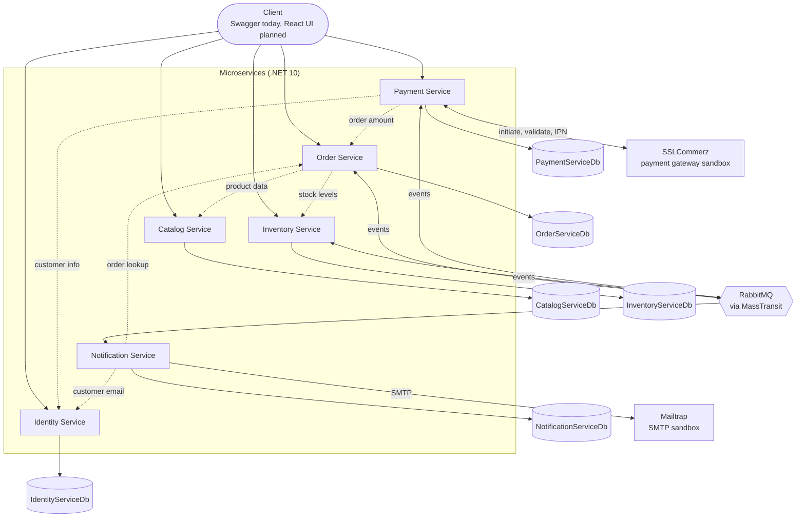
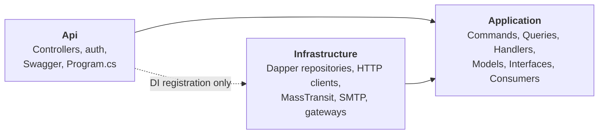
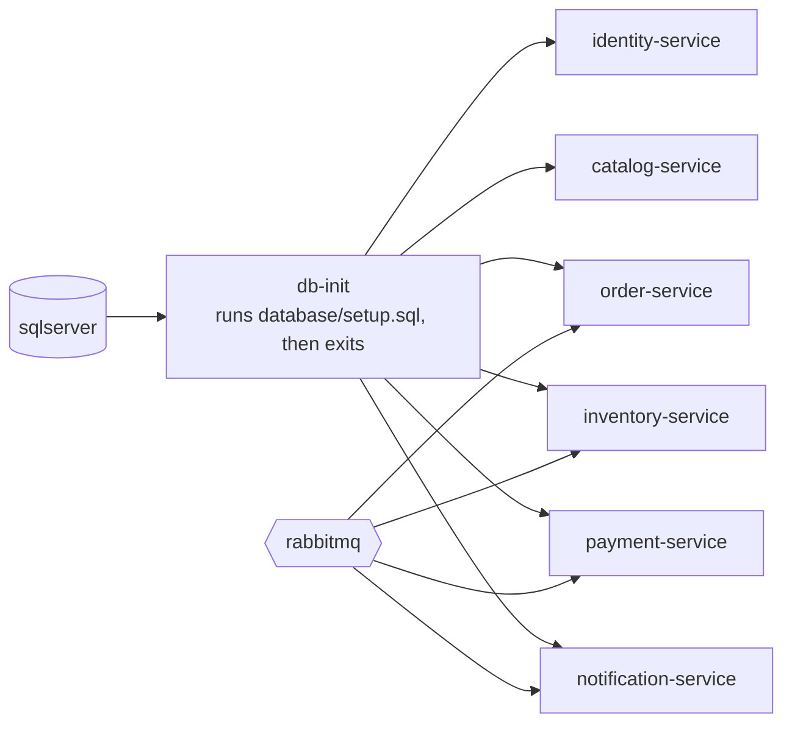
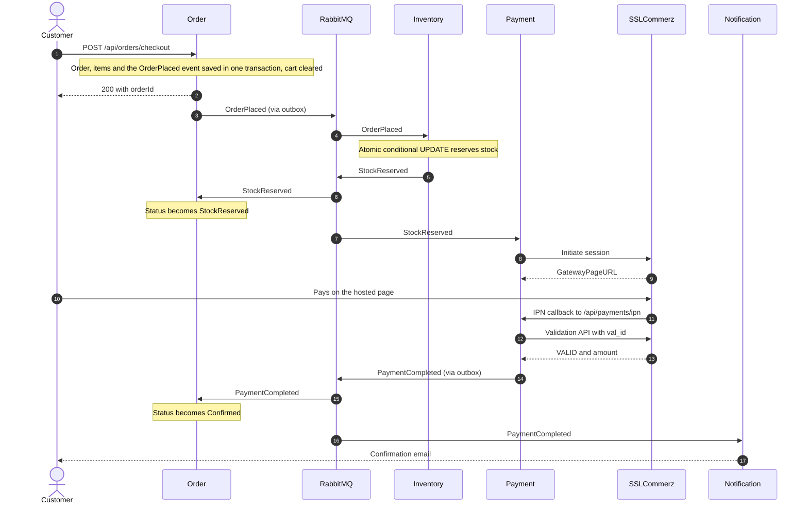
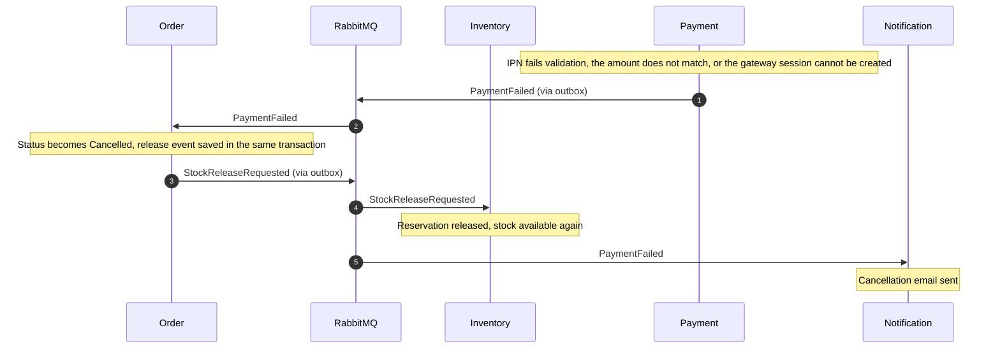
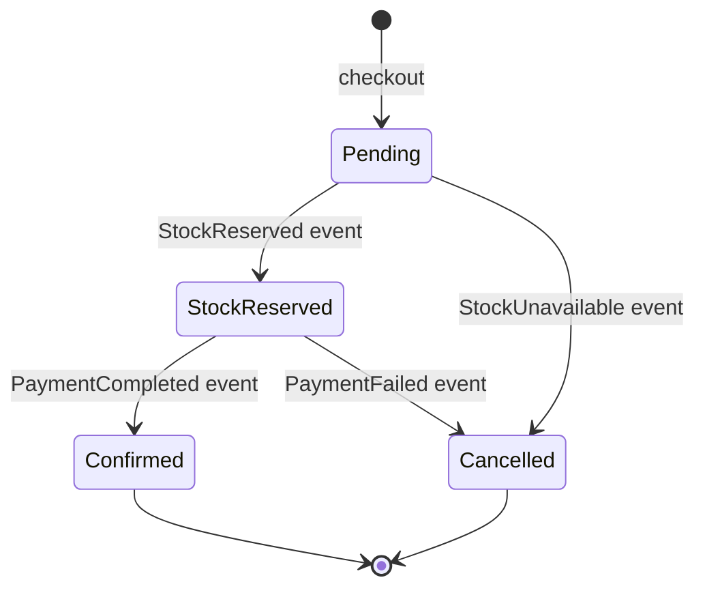
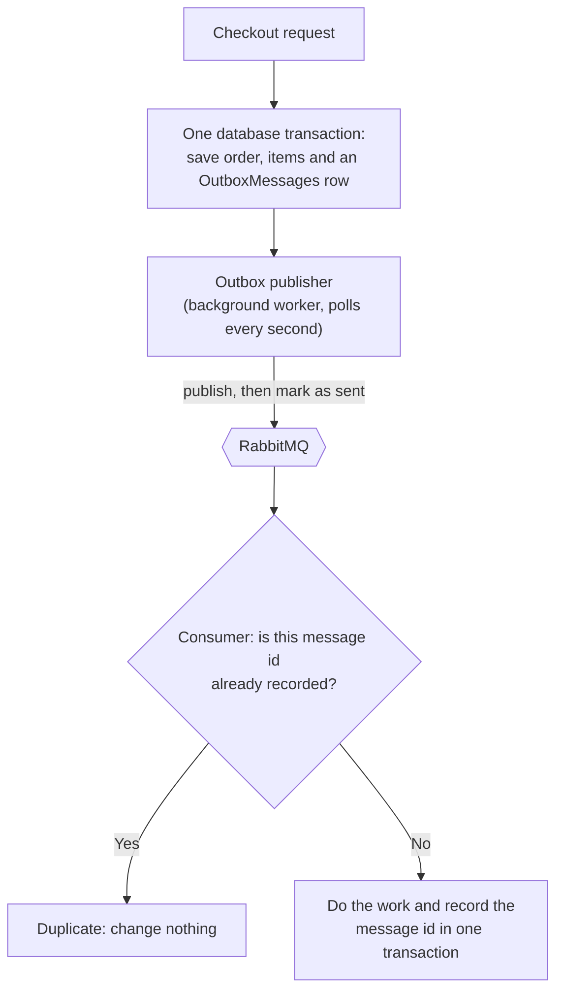
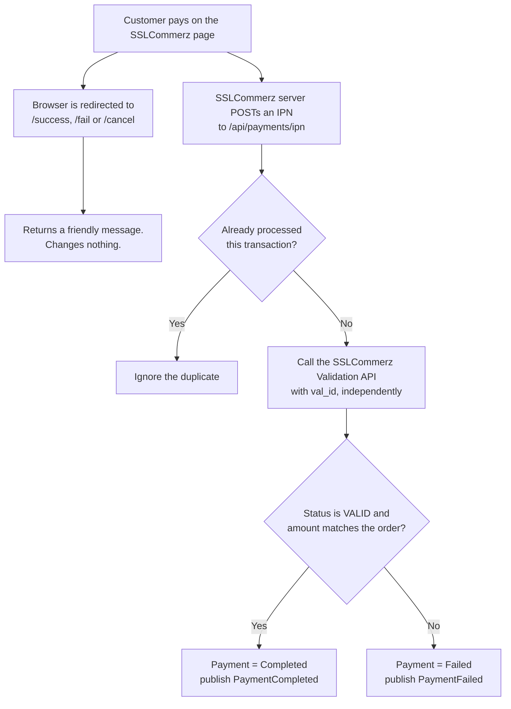

# E-Commerce Microservices Platform

> A production-style e-commerce backend built with **.NET 10**: six independently deployable services, an **event-driven Saga with compensating transactions**, **reliable messaging** (transactional outbox and idempotent consumers), a **real payment gateway integration** (SSLCommerz), and a **one-command Docker Compose environment**.


```powershell
git clone https://github.com/tusar-molla/ecommerce-microservices.git
cd ecommerce-microservices
Copy-Item .env.example .env      # then edit .env (see "Configuration")
docker compose up -d --build     # SQL Server, RabbitMQ and all six services
```

Then open the Swagger pages listed under [Getting started](#getting-started).

---

## Contents

- [Overview](#overview)
- [Architecture](#architecture)
- [The checkout Saga](#the-checkout-saga)
- [Reliability: outbox and idempotency](#reliability-outbox-and-idempotency)
- [Payment security model](#payment-security-model)
- [Security overview](#security-overview)
- [Engineering highlights](#engineering-highlights)
- [Service reference](#service-reference)
- [Tech stack](#tech-stack)
- [Getting started](#getting-started)
- [Configuration](#configuration)
- [Try it: end-to-end walkthrough](#try-it-end-to-end-walkthrough)
- [Useful commands and troubleshooting](#useful-commands-and-troubleshooting)
- [Design decisions and trade-offs](#design-decisions-and-trade-offs)
- [Known limitations and roadmap](#known-limitations-and-roadmap)
- [Repository structure](#repository-structure)

---

## Overview

A customer browses a catalog, fills a cart, checks out, pays through a real payment gateway, and gets an email. Behind that flow, six services each own one business capability and one database, and coordinate through events instead of shared tables or chained synchronous calls.

| Service | Owns | Highlights |
|---|---|---|
| **Identity** | Users, roles, tokens | JWT access + refresh tokens with rotation, immediate revocation on logout, role-based authorization |
| **Catalog** | Products, categories, images | Soft delete, pagination and filtering, multi-image support, batched lookups for other services |
| **Order** | Cart, orders | Live-priced cart, atomic checkout with price snapshots, transactional outbox, Saga participant, Hangfire cleanup jobs |
| **Inventory** | Stock, reservations | Atomic oversell-safe reservation, idempotent consumers, compensating stock release, admin stock tools |
| **Payment** | Payments | SSLCommerz sandbox (redirect + IPN), server-side validation, duplicate-callback protection, transactional outbox |
| **Notification** | Notification log | Event-driven transactional email (SMTP), send-once guard, audit trail |

The full flow was verified end to end against the real SSLCommerz sandbox: the success path (paid, order confirmed, email sent) and the failure path (payment cancelled, order cancelled, stock released).

The stock guarantee was checked with a concurrent-checkout test: 10 customers checking out at the same instant for 3 units of stock gave exactly 3 reserved orders and 7 cancelled, with stock never going negative (repeated 5 times).

---

## Architecture

### System view



**How to read it:** solid arrows are client requests, data access, and asynchronous events. Dotted arrows are synchronous HTTP calls between services. Each service has its own database (one SQL Server instance, separate databases) and never reads another service's tables.

### Inside each service

Every service uses the same three-project layout, so once you've read one, you've read them all.



- **Application** doesn't depend on Infrastructure or Api. It defines the interfaces (`IPaymentGateway`, `IEmailSender`, `IStockRepository`, `IFileStorageService`) that Infrastructure implements.
- **Infrastructure** implements those interfaces. Swapping SSLCommerz for Stripe, Mailtrap for SendGrid, or local disk for S3 means writing one new class and changing one line of DI, with no changes to business logic.
- **Api** is thin. Controllers only dispatch to MediatR (CQRS).
- There is deliberately no separate Domain project (see [trade-offs](#design-decisions-and-trade-offs)).

### What Docker Compose runs



Arrows show start-up order. Services that use messaging wait for RabbitMQ to be healthy. Every service waits for `db-init`, an idempotent job that creates all databases and tables and then exits. Inside the Compose network, services reach each other by name over plain HTTP (for example `http://catalog-service:8080`).

### Shared code

`ECommerce.Contracts` is the only code shared between services. It contains event shapes and nothing else, no logic. Services never reference each other's projects.

---

## The checkout Saga

Checkout touches four services but uses no distributed transaction. Each service does its own local work and announces the result as an event (a **choreographed Saga**). When something fails, services run compensating actions instead of rolling back.

### Success path



### Failure paths and compensation



| Failure | Detected by | Result |
|---|---|---|
| Not enough stock at reservation time | Inventory (conditional UPDATE affects 0 rows) | `StockUnavailable` → order cancelled, customer emailed. Any items already reserved for that order are rolled back inside Inventory. |
| Payment declined, cancelled, or invalid | Payment (gateway validation) | `PaymentFailed` → order cancelled, stock released, customer emailed |
| Gateway session cannot be created (bad credentials, outage) | Payment (initiate call fails) | `PaymentFailed`, same compensation as a declined payment |
| Gateway validation API unreachable during an IPN | Payment (validation call throws) | The IPN request fails and nothing is recorded, so the gateway can retry. The payment is not marked failed. |
| Amount in the callback differs from the order total | Payment (amount check) | Treated as a failed payment |
| Duplicate IPN from the gateway | Payment (`ProcessedIpnCallbacks`) | Ignored |
| Duplicate event delivery | The receiving consumer (see [Reliability](#reliability-outbox-and-idempotency)) | No second effect |

### Order lifecycle



Transitions are forward-only. Each status change is a conditional `UPDATE ... WHERE Status IN (...)`, so a late or duplicate event cannot move an order backward (for example, from `Confirmed` back to `StockReserved`). `Shipped` and `Delivered` exist in the status enum for a future fulfillment flow but are not driven by any event yet.

### Events

| Event | Published by | Consumed by |
|---|---|---|
| `OrderPlaced` | Order (outbox) | Inventory |
| `StockReserved` | Inventory | Order, Payment |
| `StockUnavailable` | Inventory | Order, Notification |
| `PaymentCompleted` | Payment (outbox) | Order, Notification |
| `PaymentFailed` | Payment (outbox) | Order, Notification |
| `StockReleaseRequested` | Order (outbox) | Inventory |

Each consumer has its own queue (for example `inventory-order-placed-queue`, `notification-payment-failed-queue`), so one event can fan out to several services independently.

---

## Reliability: outbox and idempotency

Two problems come with sending events between services:

1. **The dual-write problem.** Saving to the database and publishing to RabbitMQ are two separate steps. A crash between them would save an order and lose its event, leaving the order stuck.
2. **Duplicates.** RabbitMQ and the outbox guarantee *at least once* delivery, so the same event can arrive twice (a redelivery after a crash, or a republish). Handling it twice must not repeat the effect.



**Transactional outbox.** The event is written to an `OutboxMessages` table in the same transaction as the business change, so the two succeed or fail together. A background worker publishes unsent rows and marks them sent. If RabbitMQ is down, checkout still succeeds and the events wait in the table until the broker is back. The outbox row's id becomes the message id, so a republished event carries the same id as the original. A daily Hangfire job deletes processed rows older than 7 days (`Outbox:RetentionDays`), keeping unsent rows and rows parked as dead.

**Idempotent consumers.** Each consumer makes a repeated message harmless:

| Where | Mechanism | Protects against |
|---|---|---|
| Order, checkout | Cart cleared and order written in one transaction; the delete must match the cart's item count | A double-click or concurrent submit creating two orders |
| Order, checkout | `OrderPlaced` saved through the outbox | Losing the event after the order is saved |
| Order, status consumers | Forward-only conditional `UPDATE` | A late or duplicate event moving an order backward |
| Order, `PaymentFailed` | Cancels only if still `Pending` or `StockReserved`; the release event goes through the outbox in the same transaction | A duplicate publishing a second stock release |
| Inventory, `OrderPlaced` | Message id claimed in `ProcessedMessages` in the same transaction as the reservation; a savepoint undoes the stock changes when an item is short; a duplicate repeats the saved result | Reserving stock twice, or half-reserving after a crash |
| Inventory, `StockReleaseRequested` | Releases only reservations still marked `Reserved` | A duplicate adding stock back twice |
| Payment, IPN | Processed marker, payment update and result event written in one transaction | Losing a payment confirmation after the customer has paid |
| Payment, `StockReserved` | The failed payment and its `PaymentFailed` event saved together | A gateway failure never reaching the order |
| Notification | Skips the email if one was already recorded as sent for that order and type | Sending the same email twice |

These were checked by injecting the failure each one protects against: replaying the same message twice through the RabbitMQ management API, stopping RabbitMQ during checkout, replaying an IPN, and firing concurrent requests.

---

## Payment security model

The payment flow rests on one rule: **nothing a customer's browser can reach is allowed to mark an order as paid.**



- The `/success`, `/fail`, and `/cancel` URLs are ordinary public endpoints. Anyone can visit them, so they only display a message.
- The IPN body is not trusted either. Payment Service takes the `val_id` from it and asks SSLCommerz directly whether the transaction is real and what amount was paid. Only that answer counts.
- A customer can forge a request to our server. They cannot forge SSLCommerz's answer to a server-to-server call.
- If the validation API is unreachable, the IPN fails instead of marking a possibly paid order as failed, so the gateway retries.

---

## Security overview

| Area | What is in place |
|---|---|
| **Authentication** | JWT bearer tokens; BCrypt password hashing; single-use refresh tokens with rotation |
| **Revocation** | Logout revokes the refresh token and blocklists the access token's `jti`, checked by middleware between authentication and authorization, so a token stops working immediately |
| **Authorization** | Role checks (`Customer`, `Admin`) on every write endpoint; no self-service path to elevated roles |
| **Object-level access (IDOR)** | Orders and payments are returned only to their owner (404 otherwise). The user id always comes from the token, never from the request body. |
| **Payments** | Browser redirects are display-only; the IPN is verified server-to-server including the amount; duplicate IPNs are ignored |
| **Service-to-service calls** | `/internal/...` endpoints require an `X-Internal-Api-Key` header, separate from customer JWTs |
| **Secrets** | Nothing secret is committed. Config lives in a git-ignored `.env` (Docker) or `appsettings.Development.json` (IDE). Both are excluded from images through `.dockerignore`. Compose refuses to start without the SQL password, JWT key and internal key. |
| **Network exposure** | SQL Server and RabbitMQ are published on `127.0.0.1` only. Services reach each other over the Compose network. |
| **Input handling** | Parameterized Dapper queries throughout; FluentValidation on commands; image uploads checked for type and size; outbox payloads are deserialized only into known contract types |
| **Data integrity** | Prices are snapshotted at checkout; products are soft-deleted; multi-step writes run in transactions |

Known security limitations are listed under [Known limitations](#known-limitations-and-roadmap).

---

## Engineering highlights

| Topic | What was done |
|---|---|
| **Overselling prevention** | Stock reservation is a single conditional `UPDATE ... WHERE QuantityAvailable >= @qty`, so the check and the decrement can't be separated by a concurrent request. A multi-item order that comes up short is rolled back as a unit. Verified with a 10-way concurrent checkout test. |
| **Reliable messaging** | Transactional outbox for the events that must not be lost, and idempotent consumers so duplicates are harmless. See [Reliability](#reliability-outbox-and-idempotency). |
| **Compensating transactions** | Payment failure triggers order cancellation and a `StockReleaseRequested` event that Inventory handles idempotently. |
| **Gateway trust boundary** | Browser redirects are display-only. The IPN is cross-checked against SSLCommerz's Validation API, including amount, and deduplicated by transaction id. |
| **Immediate token revocation** | JWTs are stateless, so logout alone can't invalidate an access token. A `jti` blocklist behind `ITokenBlocklistService` (SQL today, Redis later) closes the gap. |
| **IDOR protection** | `GetOrderById` and the payment queries compare the resource's `UserId` to the caller's JWT and return 404 on mismatch. |
| **Live vs snapshot data** | Cart lines store only `ProductId` and quantity and are priced live from Catalog. At checkout, name and price are copied into `OrderItems` so later catalog changes can't rewrite history. |
| **Fail-fast validation** | `AddToCart` checks live stock, including the quantity already in the cart, and rejects with a clear message before anything is written. The authoritative check still happens atomically in Inventory. |
| **Avoiding N+1** | Images for a page of products are loaded in one `IN (...)` query. Order Service uses Catalog's bulk endpoint instead of one call per cart line. |
| **Transactions** | Order, items, cart clearing and the `OrderPlaced` event are written in one transaction. |
| **Replaceable infrastructure** | Gateway, email, file storage, token blocklist, and messaging all sit behind interfaces defined in the Application layer. |
| **One-command environment** | Multi-stage Dockerfiles per service, a Compose file with health checks and start-up ordering, and an idempotent `db-init` job. All settings come from environment variables, with no secrets in git or in images. |
| **Background jobs** | Hangfire deletes carts untouched for 30 days and processed outbox rows older than 7 days. |

---

## Service reference

<details>
<summary><b>Identity Service</b> (<code>:8081</code>, <code>IdentityServiceDb</code>)</summary>

| Method | Route | Access | Purpose |
|---|---|---|---|
| POST | `/api/auth/register` | Public | Register (always a Customer) |
| POST | `/api/auth/login` | Public | Returns access and refresh tokens |
| POST | `/api/auth/refresh` | Public | Exchange a refresh token (single-use, rotated) |
| POST | `/api/auth/logout` | Authenticated | Revokes the refresh token and blocklists the access token |
| GET | `/api/auth/me` | Authenticated | Current user |
| GET | `/api/auth/internal/{userId}` | Internal API key | User lookup for other services |

Roles: `Customer`, `Admin`. The first Admin is promoted manually in the database, deliberately, since there is no self-service path to elevated roles.

Tables: `Users`, `RefreshTokens`, `RevokedAccessTokens`.
</details>

<details>
<summary><b>Catalog Service</b> (<code>:8082</code>, <code>CatalogServiceDb</code>)</summary>

| Method | Route | Access | Purpose |
|---|---|---|---|
| GET | `/api/products` | Public | Paged list, optional `categoryId` filter |
| GET | `/api/products/{id}` | Public | Product with images |
| GET | `/api/products/bulk?ids=` | Public | Batched lookup (used by Order) |
| GET | `/api/products/ids` | Public | All active product ids (used by Inventory) |
| POST | `/api/products` | Admin | Create with multiple images (`multipart/form-data`) |
| PUT | `/api/products/{id}` | Admin | Update (SKU is immutable) |
| DELETE | `/api/products/{id}` | Admin | Soft delete |
| POST | `/api/products/{id}/image` | Admin | Add an image |
| PATCH | `/api/products/{id}/images/{imageId}/set-primary` | Admin | Choose the primary image |
| DELETE | `/api/products/{id}/images/{imageId}` | Admin | Remove an image |
| GET / POST | `/api/categories` | Public / Admin | List and create categories |

Images live in a generic `Files` table (`EntityType` + `EntityId`) so other entities can reuse it. Storage is local disk (a Docker volume) behind `IFileStorageService`, ready for an S3 implementation.

Tables: `Categories`, `Products`, `Files`.
</details>

<details>
<summary><b>Order Service</b> (<code>:8083</code>, <code>OrderServiceDb</code>)</summary>

| Method | Route | Access | Purpose |
|---|---|---|---|
| GET | `/api/cart` | Customer | Cart with live price, image, and stock availability message |
| POST | `/api/cart/items` | Customer | Add (idempotent: same product increments quantity) |
| DELETE | `/api/cart/items/{productId}` | Customer | Remove a line |
| DELETE | `/api/cart` | Customer | Clear the cart |
| POST | `/api/orders/checkout` | Customer | Convert the cart to an order and start the Saga |
| GET | `/api/orders/{orderId}` | Customer | Own order only |
| GET | `/api/orders/my-orders` | Customer | Order history |
| GET | `/api/orders/internal/{orderId}` | Internal API key | Order lookup for other services |
| | `/hangfire` | Development only | Job dashboard |

Consumes: `StockReserved`, `StockUnavailable`, `PaymentCompleted`, `PaymentFailed`. Publishes through the outbox: `OrderPlaced`, `StockReleaseRequested`.

Tables: `Carts`, `CartItems`, `Orders`, `OrderItems`, `OutboxMessages` (plus `HangfireDb` for job storage).
</details>

<details>
<summary><b>Inventory Service</b> (<code>:8084</code>, <code>InventoryServiceDb</code>)</summary>

| Method | Route | Access | Purpose |
|---|---|---|---|
| POST | `/api/stock` | Admin | Set initial stock for a product (rejected if it already exists) |
| POST | `/api/stock/adjust` | Admin | Add or remove stock (cannot go negative) |
| GET | `/api/stock/missing` | Admin | Products that exist in Catalog but have no stock record |
| GET | `/api/stock-levels?productIds=` | Public | Available quantities |

Consumes: `OrderPlaced`, `StockReleaseRequested` (both idempotent). Publishes: `StockReserved`, `StockUnavailable`.

Cataloging a product and stocking it are deliberately separate business actions, so there is no hidden coupling between the two services. `GET /api/stock/missing` is the reconciliation tool for products someone forgot to stock.

Tables: `Stock`, `StockReservations`, `ProcessedMessages`.
</details>

<details>
<summary><b>Payment Service</b> (<code>:8085</code>, <code>PaymentServiceDb</code>)</summary>

| Method | Route | Access | Purpose |
|---|---|---|---|
| GET | `/api/payments/{orderId}/redirect-url` | Customer | Hosted checkout URL for the order |
| GET | `/api/payments/order/{orderId}` | Customer | Own payment status |
| GET | `/api/payments/my-payments` | Customer | Payment history |
| POST | `/api/payments/success`, `/fail`, `/cancel` | Gateway redirect | Display only, change nothing |
| POST | `/api/payments/ipn` | Gateway callback | Validated, authoritative payment result |

Consumes: `StockReserved`. Publishes through the outbox: `PaymentCompleted`, `PaymentFailed`.

Tables: `Payments`, `ProcessedIpnCallbacks`, `OutboxMessages`.
</details>

<details>
<summary><b>Notification Service</b> (<code>:8086</code>, <code>NotificationServiceDb</code>)</summary>

No public API. It only reacts to events.

| Event | Email |
|---|---|
| `PaymentCompleted` | Order confirmed |
| `PaymentFailed` | Order cancelled, payment failed |
| `StockUnavailable` | Order cancelled, item unavailable |

A shared dispatcher resolves order, then user, then email address through the other services, skips the send if one was already recorded as sent for that order and type, and writes every attempt (`Sent` or `Failed` with the error) to `NotificationLogs`. A failed send is logged and not retried.

Tables: `NotificationLogs`.
</details>

---

## Tech stack

| Area | Choice |
|---|---|
| Runtime | .NET 10, ASP.NET Core Web API |
| Data access | Dapper (raw SQL), SQL Server, one database per service |
| Patterns | CQRS with MediatR, repository per aggregate, FluentValidation, transactional outbox, idempotent consumers |
| Messaging | RabbitMQ through MassTransit 8 |
| Auth | JWT bearer, BCrypt password hashing, refresh token rotation |
| Payments | SSLCommerz sandbox (hosted checkout and IPN) |
| Email | MailKit over SMTP, Mailtrap sandbox inbox |
| Background jobs | Hangfire (SQL Server storage) |
| API docs | Swagger / OpenAPI per service |
| Containers | Docker, Docker Compose (multi-stage builds) |
| Local tooling | ngrok (public URL for the payment IPN) |

---

## Getting started

### Prerequisites

- [Docker Desktop](https://www.docker.com/products/docker-desktop/) with at least **6 GB of memory** allocated (SQL Server alone needs 2 GB)
- Free sandbox accounts for [SSLCommerz](https://developer.sslcommerz.com/registration/) and [Mailtrap](https://mailtrap.io)
- [ngrok](https://ngrok.com), only if you want to complete a real sandbox payment

You do **not** need the .NET SDK or a local SQL Server to run the stack in Docker.

### 1. Clone and configure

```powershell
git clone https://github.com/tusar-molla/ecommerce-microservices.git
cd ecommerce-microservices
Copy-Item .env.example .env        # macOS/Linux: cp .env.example .env
```

Open `.env` and fill it in. See [Configuration](#configuration) for what each value does. `.env` is git-ignored.

### 2. Start everything

```powershell
docker compose up -d --build
docker compose ps -a
```

The first run takes a few minutes (it downloads the SQL Server, .NET, and RabbitMQ images). When it's done, `db-init` shows `Exited (0)`, which means the databases were created, and everything else shows `running`.

### 3. Open the services

| Service | Swagger |
|---|---|
| Identity | http://localhost:8081/swagger |
| Catalog | http://localhost:8082/swagger |
| Order | http://localhost:8083/swagger |
| Inventory | http://localhost:8084/swagger |
| Payment | http://localhost:8085/swagger |
| Notification | http://localhost:8086/swagger (no endpoints, it only consumes events) |
| RabbitMQ UI | http://localhost:15672 (user and password from `.env`, default guest / guest) |
| SQL Server | `127.0.0.1,14333`, login `sa`, password `SA_PASSWORD` from `.env` |

Connect to SQL Server with `127.0.0.1`, not `localhost`. The port is published on IPv4 loopback only, and `localhost` can resolve to IPv6, which is refused.

A token issued by Identity works on every service, because they all share the same `JWT_SECRET_KEY`. Use **Authorize** in each Swagger page.

### 4. Testing real payments (optional)

SSLCommerz's servers must be able to reach your machine to deliver the payment callback (IPN):

```powershell
ngrok http 8085
```

Put the forwarding URL in `.env` as `PAYMENT_PUBLIC_BASE_URL`, then recreate Payment Service:

```powershell
docker compose up -d payment-service
```

Without this, everything up to creating the payment session works, but completing the payment does not.

### Running from an IDE instead

Each Api project has an `appsettings.Development.example.json`. Copy it to `appsettings.Development.json` (git-ignored), fill it in, and run the services with `dotnet run --project <Service>/<Service>.Api --launch-profile https`. In this mode you need a local SQL Server (run [`database/setup.sql`](database/setup.sql) against it) and RabbitMQ (`docker compose up -d rabbitmq` works). Ports are in each project's `Properties/launchSettings.json`, and the `Services:*BaseUrl` values must match them. Don't run the same service in both modes at once, or two copies will compete for the same queue.

---

## Configuration

Nothing secret is committed. In Docker, configuration comes from `.env`, which Compose turns into environment variables (`Jwt__SecretKey` sets the setting `Jwt:SecretKey`). The committed `appsettings.json` files contain only logging settings.

| `.env` variable | Purpose |
|---|---|
| `SA_PASSWORD` | SQL Server `sa` password. 8+ characters with upper, lower, digit and symbol. Avoid `; = " ' $` and spaces. It only takes effect when the SQL volume is first created. |
| `JWT_SECRET_KEY` | Signing key shared by all services (32+ random characters) |
| `INTERNAL_API_KEY` | Shared key for the internal service-to-service endpoints |
| `RABBITMQ_USER`, `RABBITMQ_PASSWORD` | Broker credentials (default guest / guest) |
| `SSLCOMMERZ_STORE_ID`, `SSLCOMMERZ_STORE_PASSWORD` | Payment gateway sandbox credentials |
| `PAYMENT_PUBLIC_BASE_URL` | Public URL of Payment Service, used for the gateway callbacks (your ngrok URL) |
| `SMTP_USERNAME`, `SMTP_PASSWORD` | Mailtrap sandbox inbox credentials |

Compose refuses to start if `SA_PASSWORD`, `JWT_SECRET_KEY`, or `INTERNAL_API_KEY` is missing. If the SSLCommerz or SMTP values are empty, the stack still starts, but payments and emails fail.

Compose reads `.env` when it **creates** a container. After editing it, run `docker compose up -d` (not `restart`) so the affected services are recreated.

---

## Try it: end-to-end walkthrough

1. **Create an Admin.** Register through `POST /api/auth/register` on Identity, then promote the account with any SQL client connected to `127.0.0.1,14333`, and log in again so the token carries the role:
   ```sql
   UPDATE IdentityServiceDb.dbo.Users SET Role = 'Admin' WHERE Email = 'you@example.com';
   ```
2. **Seed the catalog.** As Admin on Catalog: create a category, then a product (`POST /api/products`, with an image if you like).
3. **Stock it.** On Inventory, `GET /api/stock/missing` shows the product has no stock record. Fix it with `POST /api/stock` and a quantity.
4. **Shop.** Register and log in as a Customer, then on Order: `POST /api/cart/items`, and `GET /api/cart` to see live price and availability.
5. **Check out.** `POST /api/orders/checkout`. Within a few seconds `GET /api/orders/{id}` shows `StockReserved`.
6. **Pay.** On Payment, `GET /api/payments/{orderId}/redirect-url`, open the returned URL in a browser, and complete a sandbox payment (test credentials are on the SSLCommerz sandbox dashboard). This needs the ngrok step above.
7. **Watch it resolve.** The order becomes `Confirmed`, and the email appears in your Mailtrap inbox. The ngrok inspector at http://127.0.0.1:4040 shows the IPN arriving.
8. **Break it on purpose.** Cancel the payment on the gateway page instead. The order becomes `Cancelled`, `Stock.QuantityAvailable` returns to its earlier value, and a cancellation email is sent.
9. **Try the reliability features.** Run `docker compose stop rabbitmq`, check out, and note that checkout still succeeds. Then `docker compose start rabbitmq`: the order moves on by itself once the outbox publisher reconnects.

---

## Useful commands and troubleshooting

| Task | Command |
|---|---|
| Start or update everything | `docker compose up -d --build` |
| See status | `docker compose ps -a` |
| Follow one service's logs | `docker compose logs -f order-service` |
| Rebuild one service after a code change | `docker compose up -d --build order-service` |
| Apply `.env` changes | `docker compose up -d` |
| Stop, keeping data (wait for it to finish) | `docker compose down` |
| Stop and wipe all data | `docker compose down -v` |

| Symptom | Likely cause |
|---|---|
| Order stuck at `Pending` | Inventory isn't consuming `OrderPlaced`, or the outbox row is still unsent. Check `docker compose logs inventory-service`, the RabbitMQ queues, and `OutboxMessages` in `OrderServiceDb`. |
| A service returns `401` | Token not authorized in that service's Swagger page, or it expired |
| Payment row is `Failed` with "Store Credential Error" | `SSLCOMMERZ_*` values in `.env` are missing or still the placeholders. Fix them, then `docker compose up -d payment-service`. |
| Payment stays `AwaitingGatewayRedirect` after paying | The gateway couldn't reach the IPN URL. Check ngrok is running and `PAYMENT_PUBLIC_BASE_URL` matches it. Use a **new** order afterwards, because an order's callback URLs are fixed when its payment session is created. |
| Notification rows `Failed` with "Too many emails per second" | Mailtrap's free sandbox rate limit, hit when many emails are sent at once. Emails are not retried yet (see known limitations). |
| `db-init` fails with `Msg 904 ... cannot be autostarted` | SQL Server was killed before shutting down cleanly and was still recovering. Run `docker compose up -d` again. |
| Can't connect to SQL Server from SSMS ("connection refused") | Use `127.0.0.1,14333` instead of `localhost,14333` |
| Containers keep restarting | Not enough memory. Raise it in Docker Desktop under Settings, then Resources. |
| `port is already allocated` | Another process uses 5672, 15672, 14333, or 8081-8086. Stop it, or change the left-hand port in `docker-compose.yml`. |
| Can't log in to SQL Server after changing `SA_PASSWORD` | The password was set when the volume was first created. Run `docker compose down -v` to start fresh. |
| Hangfire dashboard returns 401 | The dashboard is open in Development only. Outside Development it accepts local requests only. |

---

## Design decisions and trade-offs

- **Choreography over orchestration.** With three or four participants, independent consumers reacting to events are simple and loosely coupled. The cost is that the whole flow isn't visible in one place. If more steps are added, a MassTransit state-machine saga would centralize it.
- **At-least-once delivery plus idempotent consumers.** Exactly-once delivery isn't achievable across a database and a broker. The system accepts duplicates and makes each consumer harmless to repeat, instead of trying to prevent them.
- **A hand-written outbox on Dapper.** The outbox is a table, a repository and a small background worker. As far as I know, MassTransit's built-in outbox targets EF Core, so writing it directly kept the Dapper stack and made the pattern explicit.
- **Dapper instead of EF Core.** SQL stays explicit and fast, and the business logic doesn't need a rich domain model. That also drove the choice of three projects per service instead of four (no separate Domain project).
- **CQRS without separate read stores.** Commands and queries are separated in code with MediatR, and each service keeps one database. Splitting read and write stores adds eventual consistency and a projection to maintain, and isn't worth it without a measured scaling problem. Catalog is the natural place to try it first.
- **Catalog and Inventory are separate on purpose.** Catalog is read-heavy and changes rarely. Inventory is write-heavy and needs strong consistency. Cataloging a product and stocking it are two business events, so creating a product does not silently create stock.
- **Database per service.** No cross-service joins. Data that crosses a boundary travels by HTTP call (when needed now) or event (when it can be eventual). In Docker the databases share one SQL Server instance for convenience, but are separate databases that never reference each other.
- **Reservation is authoritative in Inventory, advisory elsewhere.** The cart shows stock hints and rejects obviously impossible quantities early, but only the atomic update in Inventory decides, because stock can change between adding to cart and checking out.
- **Configuration through the environment.** The same image runs anywhere, and only the environment variables change. RabbitMQ's host, like the database connections and service URLs, is a setting rather than a hardcoded value.
- **Test-friendly infrastructure.** Sandbox gateway, sandbox inbox, local disk storage, and SQL-backed token blocklist are all behind interfaces, so the production versions are additive changes.

---

## Known limitations and roadmap

Documented honestly so a reader knows what is and isn't covered. The project targets local use and demonstration, not production.

**Reliability gaps**

- Inventory publishes `StockReserved` and `StockUnavailable` directly, without an outbox. A redelivered `OrderPlaced` repeats the saved result, which covers a crash after the commit, but there is no outbox row to retry from.
- `Payments.OrderId` has no unique index. Two copies of the same `StockReserved` processed at the same instant could both create a gateway session.
- Consumers have no explicit retry policy. A consumer that throws may leave its message in an error queue that nothing monitors.
- The outbox publisher assumes one running instance of its service. Two copies would publish the same rows twice.
- Payment's outbox table has no cleanup job (only Order's does).
- **Failed emails are not retried.** Notification makes one send attempt and records `Failed` with the error. During a burst (for example 7 simultaneous cancellations) Mailtrap's sandbox rejected 6 of 7 emails with "Too many emails per second", and those customers were never notified.
- A `PaymentCompleted` for an order that was already cancelled is ignored. There is no refund flow.
- The cart is cleared at checkout, before stock and payment are confirmed. A cancelled order doesn't restore it.

**Security and deployment gaps**

- Containers run with `ASPNETCORE_ENVIRONMENT=Development` (Swagger on, Hangfire dashboard unauthenticated), and traffic between services is plain HTTP.
- Every service connects to SQL Server as `sa`. A real deployment would give each service its own login limited to its own database.
- All services share one symmetric JWT signing key. A real deployment would use asymmetric keys or a dedicated identity provider.
- Secrets come from a git-ignored `.env`. A real deployment would use a secrets manager.
- No rate limiting on login, registration or checkout.
- MediatR 14 logs a licence warning outside development and testing. A production deployment would need a licence or an earlier version.

**Testing**

- There are no automated tests yet. The flows were verified manually and against the real sandbox: duplicate messages replayed through RabbitMQ, the broker stopped during checkout, replayed IPNs, and concurrent checkouts.

**Roadmap**

- [x] Docker Compose for one-command startup
- [x] Transactional outbox for checkout and payment confirmation
- [x] Idempotent consumers in Inventory, Order and Payment
- [x] Concurrency test for stock reservation (run manually)
- [ ] Automated unit and integration tests, with the concurrency test scripted
- [ ] CI pipeline (build and test on every push)
- [ ] Retry for failed notification emails, with backoff
- [ ] Outbox for Inventory, unique index on `Payments.OrderId`, explicit consumer retry policy
- [ ] Refund flow for payments that arrive after cancellation
- [ ] API Gateway (YARP) as a single entry point
- [ ] Redis for caching and the token blocklist, plus rate limiting
- [ ] Distributed tracing (OpenTelemetry)
- [ ] S3-backed file storage
- [ ] React frontend with SignalR for live order status

---

## Repository structure

```
ecommerce-microservices/
├── ECommerce.Contracts/          # shared event contracts (only shared code)
├── IdentityService/
│   ├── IdentityService.Api/
│   ├── IdentityService.Application/
│   ├── IdentityService.Infrastructure/
│   └── Dockerfile
├── CatalogService/               # same layout in every service
├── OrderService/
├── InventoryService/
├── PaymentService/
├── NotificationService/
├── database/
│   └── setup.sql                 # creates all databases and tables (idempotent)
├── docker-compose.yml            # SQL Server, RabbitMQ, db-init and the six services
├── .env.example                  # template for the git-ignored .env
├── .dockerignore
└── README.md
```

---

## Author

**Mohammad Tusar Molla**, .NET backend developer.
GitHub: [@tusar-molla](https://github.com/tusar-molla)

<!-- Optional: add screenshots under docs/images and link them here (Swagger, RabbitMQ queues, the Mailtrap confirmation email, the ngrok IPN inspector). -->
